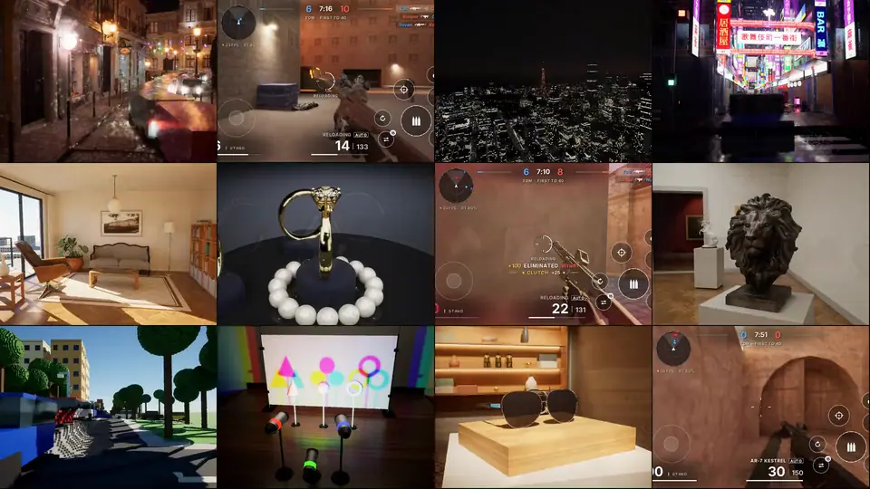
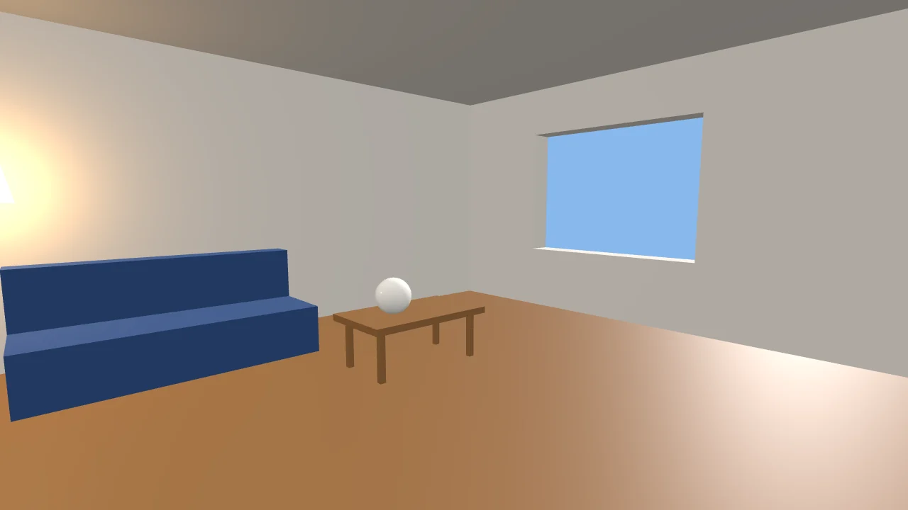
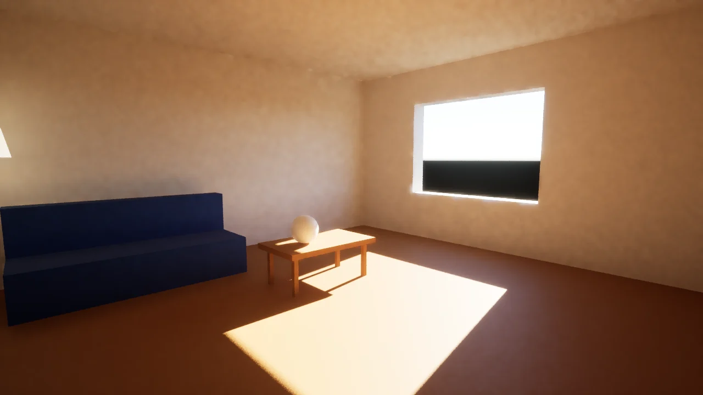
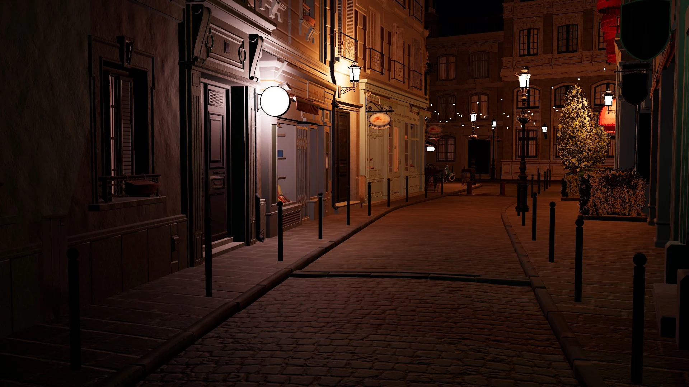
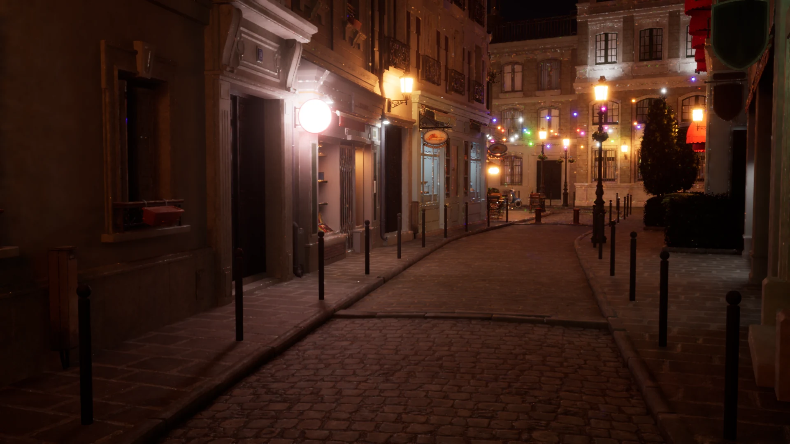
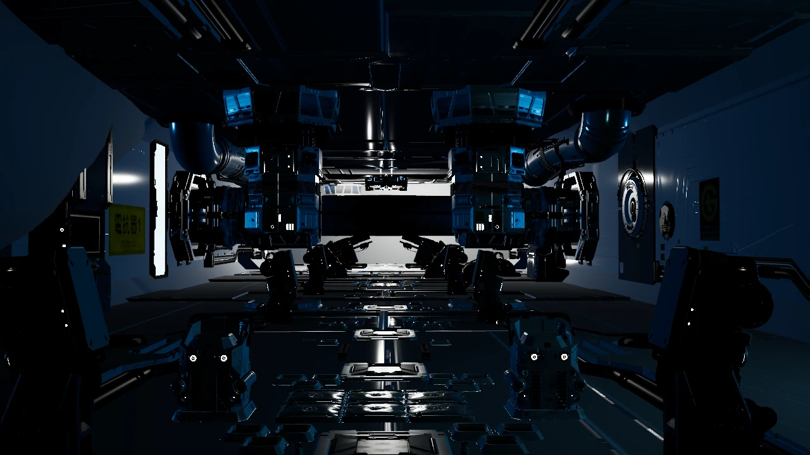
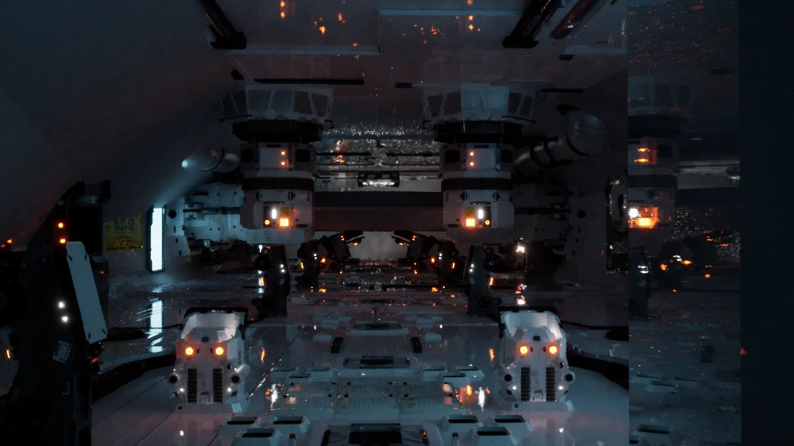

<p align="center">
  <a href="https://threert.dev">
    <picture>
      <source media="(prefers-color-scheme: dark)" srcset="site/brand/mark.svg">
      
    </picture>
  </a>
</p>

<h1 align="center">ThreeRT</h1>

<p align="center"><b>Hardware ray-traced three.js.</b></p>

<p align="center">
  A real-time path tracer behind a three.js-style API. Write the scene you would write in three.js,<br>
  and every light in it is traced on the GPU's ray-tracing hardware, at 60 fps.
</p>

<p align="center">
  <a href="https://github.com/meshy-dev/ThreeRT/actions/workflows/ci.yml"></a>
  <a href="https://www.npmjs.com/package/@threert/scene"></a>
  <a href="LICENSE"></a>
  <a href="https://threert.dev/download/"></a>
  <a href="https://discord.gg/n7vsVmAKCK"></a>
</p>

<p align="center">
  <a href="https://threert.dev"><b>Website</b></a> ·
  <a href="https://threert.app">Apps</a> ·
  <a href="https://threert.dev/download/">Download</a> ·
  <a href="https://threert.dev/docs/">Docs</a> ·
  <a href="https://discord.gg/n7vsVmAKCK">Discord</a> ·
  <a href="https://x.com/ThreeRT3D">X</a>
</p>

<p align="center">
  <a href="https://threert.dev"></a>
  <br>
  <sub>ThreeRT, live on an Apple M3 Max: this repository's demos and OpenStrike, a shooter built on the engine.</sub>
</p>

## Three + RT

**Three**, for the API you already know. **RT**, for the three things it adds:

- **Ray tracing.** Every light is traced: shadows, bounce light, reflections, and glowing surfaces that light the room. No shadow maps, no light probes, no lightmaps, no baking.
- **Real time.** 60 fps in production scenes with the camera moving: Amazon Lumberyard Bistro and Beeple's Zero-Day, on a laptop. Not a still that converges once you stop.
- **Runtime.** A game runtime, not only a renderer. Scene code and game logic run inside the engine, and the same file runs as plain three.js in any browser.

## Hello world looks right

Write a scene at tutorial size and leave every setting at its default.

```ts
import { Scene, PerspectiveCamera, Mesh, BoxGeometry, MeshStandardMaterial, DirectionalLight, SkyAtmosphere } from "@threert/scene";

export default function build() {
  const scene = new Scene();
  const sun = new DirectionalLight(0xffffff, 90000).setSunAngles(28, 100); // lux
  scene.add(sun);
  scene.environment = new SkyAtmosphere({ sun });

  const plaster = new MeshStandardMaterial({ color: 0xd9d4cc, roughness: 0.92 });
  const wall = new Mesh(new BoxGeometry(6.6, 3, 0.3), plaster);
  wall.position.set(0, 1.5, -3.15);
  scene.add(wall);
  // ... the rest of the room: a floor, a window, a sofa, a lamp

  const camera = new PerspectiveCamera(58, 16 / 9, 0.05, 200);
  camera.position.set(-2.3, 1.45, 2.4);
  camera.lookAt(1.0, 0.9, -1.2);
  scene.add(camera);
  return { scene, camera };
}
```

| three.js, as written | ThreeRT, all defaults |
|---|---|
|  |  |

The sun through the window, the sky, the bounce light off the floor and the lamp's glow come from tracing the scene. Light is in physical units: the sun is 90,000 lux, and an emissive surface is a light source. The whole file is [`scenes/sun-room.ts`](scenes/sun-room.ts).

## Against three.js at full power

The same scene file, run by both engines on the same Mac. three.js gets everything it has: shadow maps, image-based lighting and, on WebGPU, its own SSGI, SSR and TRAA.

| three.js r187 | ThreeRT |
|---|---|
|  |  |
|  |  |

| Bistro night, 1280 × 720 | Frame cost | Error against the reference (ΔE, lower is closer) |
|---|---|---:|
| **ThreeRT, live** | 15.5 ms (60 fps) | **3.4** |
| three.js, WebGPU + SSGI + SSR + TRAA | 34.7 ms (29 fps) | 10.1 |
| three.js, WebGL tuned | 15.9 ms (60 fps) | 12.1 |

The reference is an unbiased offline render (4,096 samples per pixel, no denoiser). The method, every scene, and where three.js is ahead (it draws small scenes in about 1 ms) are in [`docs/COMPARE.md`](docs/COMPARE.md).

## Get started

### Play and make games

1. **[Download ThreeRT](https://threert.dev/download/)** for macOS (14 or later, Apple silicon) or iPhone and iPad (iOS 17 or later). The client fetches a game's code and traces it on the device's own GPU.
2. Open an example from the app's library or from [threert.app](https://threert.app), where ThreeRT apps and games are published.
3. Write your own with the `threert` command line that ships inside the Mac app:

```bash
threert create my-game
cd my-game
threert dev        # bundles on save, serves every client on your network, prints a QR code for your phone
```

The same address in any browser shows the game as three.js. The full walk-through is at [threert.dev/docs](https://threert.dev/docs/).

### Packages

| Package | What |
|---|---|
| [`@threert/scene`](packages/scene) | The three.js-style scene API: meshes, PBR materials, lights, glTF models, physics, volumes |
| [`@threert/gameplay`](packages/gameplay) | Games: state, transactional handlers, world handlers, frame scripts; input, a HUD and a channel to the app that runs the game; deterministic and replayable |
| [`@threert/voxel`](packages/voxel) | Destructible voxel levels: explosions, cuts, and pieces that break off as rigid bodies |

```bash
npm install @threert/scene @threert/gameplay
```

`threert dev` bundles these for you. Install them from npm for types, tests, or a build pipeline of your own.

### Build the engine from source

The engine is Rust and [wgpu](https://wgpu.rs): hardware ray queries where the GPU has them (Metal, Vulkan), a software BVH where it does not. You need Rust, Node 24 and [Bun](https://bun.sh).

```bash
npm install && bun scripts/setup.ts      # assets/ -> the machine's shared asset store, then fetch what is missing
node tools/build-scenes.ts                # scenes/*.ts + games -> out/bundles/<id>.js
bun renderer/build.ts                     # -> renderer/target/release/threert-render

renderer/target/release/threert-render play out/bundles/light-room.js                         # a game, in a window
renderer/target/release/threert-render render out/bundles/cornell-box.js -o out/cornell.png --spp 32   # a scene, to an image
node tools/three/open.ts scenes/bistro.ts # the same scene in three.js, in your browser
```

In the window: drag to orbit, right-drag to pan, wheel to zoom, WASD/QE to fly, `R` to reset, `P` for a snapshot.

```bash
npm test && npm run typecheck && (cd renderer && cargo test --release)   # scene API, gameplay, runtime and engine tests
npm run test:render                                                      # the render test suite, on the GPU
```

## Demos in this repository

| Demo | What | Run |
|---|---|---|
| **Light Room** | A small game: click coins, the floor, the balls, the crate and the walls | `threert-render play out/bundles/light-room.js` |
| **Kabukichō Night** | A Shinjuku night street, procedural, lit almost entirely by ~120 emissive signs; rain, fog, a taxi. `R` rain, `L` closing time, `V` viewpoint | `threert-render play out/bundles/kabukicho.js` |
| **Bistro** | Amazon Lumberyard Bistro at night: a slice, the district, and a crowd of 150 walkers and 60 vans | [`games/bistro-slice`](games/bistro-slice), [`bistro-district`](games/bistro-district), [`bistro-crowd`](games/bistro-crowd) |
| **Zero-Day** | Beeple's Zero-Day (Measure One), animated | [`games/zero-day`](games/zero-day) |
| **Tokyo** | Shinjuku and Shiba from the PLATEAU city model, with a live time of day | [`games/tokyo`](games/tokyo), [`tools/tokyo`](tools/tokyo) |
| **Voxel level** | A destructible voxel city: explosions, falling pieces, fire and smoke | [`games/voxel-level`](games/voxel-level), [`docs/VOXEL.md`](docs/VOXEL.md) |
| **Playground** | A macOS editor around the live viewport: outliner, live editing, Play-in-Editor, A/B against UE5 | `bun playground/build.ts && bun playground/run.ts` |

## Repository layout

| Directory | What |
|---|---|
| [`renderer/`](renderer) | The engine: the Rust + wgpu path tracer, live viewport, denoiser, post, and an embedded QuickJS that runs scene code (`threert-render`); `voxel-core` and `physics-core` (Rapier) also build for wasm32 |
| [`packages/`](packages) | `@threert/scene`, `@threert/gameplay`, `@threert/voxel` |
| [`scenes/`](scenes), [`games/`](games) | The reference catalog (Cornell box, material grid, Bistro, Zero-Day, …) and the playable content |
| [`tests/`](tests) | The render test suite (analytic and temporal checks) and the three.js compatibility set |
| [`tools/`](tools) | Bundling, benches and gates, the three.js comparison, the Tokyo pipeline |
| [`compare/`](compare) | Hello-world scenes side by side in three.js and ThreeRT |
| [`ue5/`](ue5) | UE5 reference captures (Lumen and the Path Tracer): the ground truth the renderer is measured against |
| [`playground/`](playground) | ThreeRT Playground, the macOS editor |
| [`site/`](site) | [threert.dev](https://threert.dev): the landing page, Download and Docs (the apps themselves are on [threert.app](https://threert.app)) |

## Documentation

- [Getting started](https://threert.dev/docs/): the client, a first scene, the dev loop, packages
- [`docs/RUNTIME.md`](docs/RUNTIME.md): how scene code runs in the engine: setup, handlers, world handlers, frame scripts, physics
- [`docs/MATERIAL_FUNCTIONS.md`](docs/MATERIAL_FUNCTIONS.md): a WGSL body on a material, run by the path tracer at every hit
- [`docs/VOXEL.md`](docs/VOXEL.md): the voxel engine, measured on a destructible level
- [`docs/COMPARE.md`](docs/COMPARE.md): three.js at its strongest against ThreeRT, in frame rate and image quality
- [`docs/PARITY.md`](docs/PARITY.md): Kabukichō against the same brief built in UE 5.8, and what the engine gained from it
- [`docs/ARCHITECTURE.md`](docs/ARCHITECTURE.md), [`docs/REPORT.md`](docs/REPORT.md): the serverless gameplay and rendering runtime the engine was built for
- [`docs/ROADMAP.md`](docs/ROADMAP.md): the goal, the plan, and what each step measured
- [Scene authoring skill](.claude/skills/threert-scene-authoring/SKILL.md): photo-referenced scenes with a coding agent

## Contributing

Issues and pull requests are welcome. [`docs/WORKFLOW.md`](docs/WORKFLOW.md) covers how work lands: one PR per item, the merge gate by tier, and CI. PRs are squash-merged.

The project started inside another repository and was extracted on 2026-11-10; PR numbers #1 to #139 in the docs, and the `cloud/` and `render-node/` directories some of them mention, refer to that one.

## Licence and credits

ThreeRT is under the [MIT licence](LICENSE). The clients for macOS and iOS are free to use and closed source.

The assets are not in the repository; `bun scripts/setup.ts` fetches them. Third-party content keeps its own terms, listed in [`docs/ASSETS.md`](docs/ASSETS.md):

- **Amazon Lumberyard Bistro**: Amazon Lumberyard (2017). **Zero-Day**: Mike Winkelmann (Beeple) and Kate Anderson (2019). Both from NVIDIA's Open Research Content Archive (ORCA), CC BY 4.0, converted from FBX to glTF.
- **Tokyo**: the 3D city model is Project PLATEAU (MLIT Japan); elevation and aerial photos are GSI; roads and places are © OpenStreetMap contributors (ODbL). The compiler in `tools/city` is from [jeantimex/tokyo](https://github.com/jeantimex/tokyo) (MIT).
- Poly Haven and Quaternius assets are CC0; the glTF sample models are Khronos'.
- The maps in the OpenStrike clips above (cs_assault, de_inferno, de_dust2) are Counter-Strike maps, © Valve, and part of neither project.

three.js is an independent open-source project; ThreeRT is not affiliated with it.

<p align="center"><sub>A research project from <a href="https://meshy.ai/">MeshyAI</a></sub></p>
