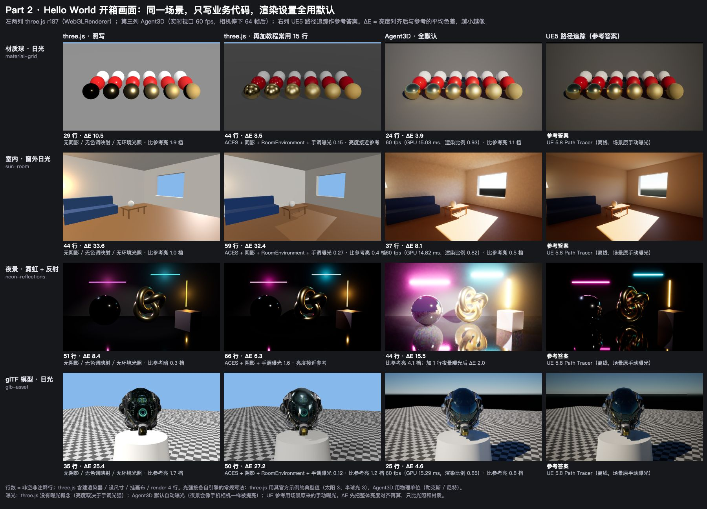
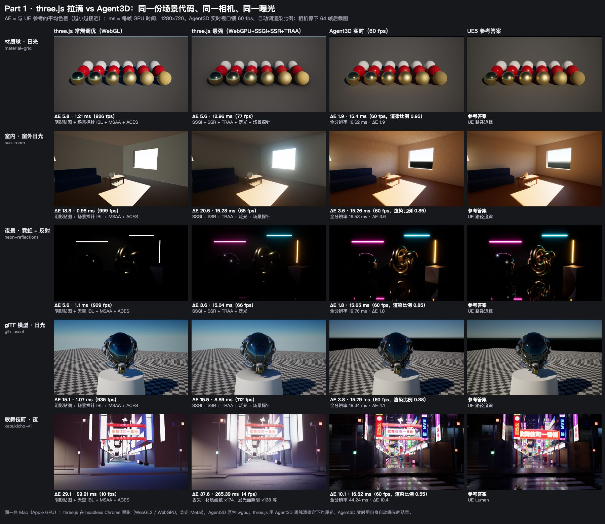
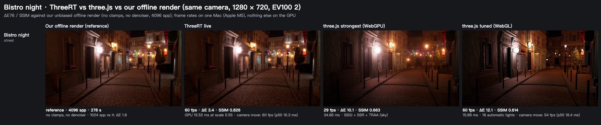
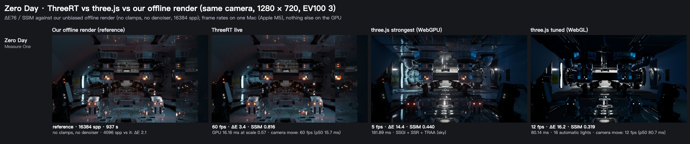

# three.js vs ThreeRT

Two questions, two experiments:

1. **Part 1, at its strongest.** If a three.js developer pushes three.js as far as it goes, how does it compare with
   ThreeRT in frame rate and in image quality?
2. **Part 2, out of the box.** If someone writes only the scene (geometry, materials, lights, camera) at hello-world
   size and leaves every rendering setting at its default, what does each engine show?

The milestone-1 sections (Bistro night, Zero Day; `node tools/milestone1.ts`) are measured against our own unbiased
offline render (no clamps, no denoiser, 4096 spp), the day-to-day reference since 2026-11-08 (ROADMAP "How we are
judged"); UE's Path Tracer audits that render at milestones.

Parts 1 and 2 are measured against UE 5.8 on the same content: the path tracer for the reference scenes, Lumen for
Kabukichō. Image quality is the mean ΔE76 against that reference (lower is closer). Everything runs on one Mac. three.js
r187 runs in headless Chrome (WebGL 2 and WebGPU, both on Metal). ThreeRT runs natively (wgpu on Metal).

```
node tools/compare/hello.ts       # part 2 -> out/compare/hello.{md,jpg}
node tools/compare/strongest.ts   # part 1 -> out/compare/strongest.{md,jpg}
```

Both need a quiet GPU (they refuse to time otherwise) and the UE references in `out/ue` and `out/ue-kb`.

## Part 2: out of the box (hello world)



Mean ΔE against the UE path tracer after aligning the overall brightness, and lines of code (non-blank, non-comment;
three.js includes the 4 lines that create the renderer, size it, attach the canvas and call `render`):

| scene | three.js as written | three.js + 15 tutorial lines | ThreeRT, all defaults (60 fps live) |
|---|---|---|---|
| material balls, daylight | 29 lines · ΔE 10.5 | 44 lines · ΔE 8.5 | 24 lines · ΔE 3.9 |
| room, sun through a window | 44 lines · ΔE 33.6 | 59 lines · ΔE 32.4 | 37 lines · ΔE 8.1 |
| night, neon + reflections | 51 lines · ΔE 8.4 | 66 lines · ΔE 6.3 | 44 lines · ΔE 15.5; with one exposure line ΔE 2.0 |
| glTF model, daylight | 35 lines · ΔE 25.4 | 50 lines · ΔE 27.2 | 25 lines · ΔE 4.6 |

- **three.js as written:** no shadows, and the sun lights the room through its walls. Metals are black (no
  environment to reflect), and there is no bounce light. Emissive surfaces light nothing, so the hello world has to
  add point lights at the lamp and the neon tubes.
- **The tutorial lines** (ACES, shadow maps, RoomEnvironment, an exposure picked by eye) add shadows and reflections.
  ΔE barely moves (−2 to +2), because what is missing is indirect light. The room stays flat and evenly lit, and the
  helmet reflects a generic studio instead of the sky and ground.
- **ThreeRT with nothing set** shows contact shadows, sky light, bounce light in the room, and reflections of the
  actual scene. On the three daylight scenes ΔE is 2–6× lower than either three.js column, in fewer lines.
- **The gap we found:** auto exposure lifts the night scene by about 4 stops, as a phone camera would. The image then
  looks like a lit room, and the live view's noise shows. One line, `camera.setManualExposure(6)`, gives ΔE 2.0.
  - UE 5.8 does the same with its defaults, and more: on this scene, built natively in UE, its default auto exposure
    lands at EV100 −4.7, against our −1.1 (`bun ue5/neon-ae.ts`, `node tools/neon-ae.ts`; ROADMAP, Known parity gaps).
  - So we leave our default as it is. A night scene states its exposure, as a UE level would. A night-aware default
    (an exposure-compensation curve) would be a feature for both engines, not a parity fix.

## Part 1: three.js at its strongest



Mean ΔE against UE (path tracer; Lumen for Kabukichō) and GPU time per frame at 1280 × 720. three.js uses whichever
of its sky and scene-probe environments is closer to UE for each scene. ThreeRT's live view holds 60 fps by lowering
its render scale; the "full res" column is its cost at a scale of 1:

| scene | three.js tuned (WebGL) | three.js strongest (WebGPU + SSGI + SSR + TRAA) | ThreeRT live, 60 fps | ThreeRT live, full res |
|---|---|---|---|---|
| material balls | ΔE 5.8 · 1.2 ms | ΔE 5.6 · 13.0 ms | ΔE 1.9 · 15.4 ms (scale 0.95) | ΔE 1.9 · 16.6 ms |
| room, window light | ΔE 18.8 · 1.0 ms | ΔE 20.6 · 15.3 ms | ΔE 3.6 · 15.3 ms (scale 0.85) | ΔE 3.6 · 19.5 ms |
| night, neon | ΔE 5.6 · 1.1 ms | ΔE 3.6 · 15.0 ms | ΔE 1.8 · 15.7 ms (scale 0.85) | ΔE 1.8 · 19.8 ms |
| glTF model | ΔE 15.1 · 1.1 ms | ΔE 15.5 · 8.9 ms | ΔE 3.8 · 15.8 ms (scale 0.88) | ΔE 4.1 · 19.3 ms |
| Kabukichō (full level) | ΔE 29.1 · 99.9 ms (10 fps) | ΔE 37.6 · 265 ms (4 fps) | ΔE 10.1 · 16.6 ms (scale 0.55) | ΔE 10.4 · 44.2 ms |

- **Small scenes, same budget.** "Strongest" three.js costs 9–15 ms per frame, the same as ThreeRT's 60 fps budget.
  Its ΔE stays where the tuned WebGL version was (5.6 / 20.6 / 3.6 / 15.5 against 5.8 / 18.8 / 5.6 / 15.1).
  ThreeRT's is 1.8–3.8, 2–6× closer to UE. Screen-space GI and reflections can only reuse what is on screen. Sky light
  through a window, bounce light from the floor, and a helmet reflecting the ground under it all need rays that
  leave the screen.
- **Big level.** On Kabukichō, three.js runs at 10 fps tuned and 4 fps strongest. Even then it is far from UE: it
  cannot express 174 material functions or emissive surfaces as lights, and SSGI washes the street out. ThreeRT holds
  60 fps at render scale 0.55 with ΔE 10.1. That is still the largest gap to UE of any scene here (§ 0.1 of the
  roadmap tracks it).
- **Where three.js is ahead:** cost. Tuned three.js draws the small scenes in about 1 ms, against ThreeRT's 15–20 ms
  (it fills the 60 fps budget by design, and at full resolution it is 17–20 ms). On a weaker GPU (laptops, phones)
  ThreeRT's floor cost is the risk, and three.js has 10× headroom. In the stills, ThreeRT's live view is also
  slightly noisy on matte walls after 64 frames (the room).


<!-- milestone1:bistro -->
### Milestone 1: Bistro night (2026-11-08)

Same Mac (Apple M5), the scene's FBX camera (first pose), 1280 × 720, EV100 2, nothing else on the GPU. ΔE76, SSIM and per-region ΔE against our unbiased offline render (no clamps, no denoiser, 4096 spp, 278 s); the 1024 spp row shows the reference's own noise.

| renderer | frame cost | ΔE | SSIM | left facade | shop and lamp | street | square | right | luminance vs reference |
|---|---|---:|---:|---:|---:|---:|---:|---:|---:|
| ThreeRT live | 15.52 ms GPU at scale 0.55 (60 fps pacing) | 3.4 | 0.826 | 1.91 | 3.93 | 3.24 | 6.16 | 2.11 | 0.916 |
| ThreeRT full resolution | 40.28 ms GPU (25 fps) | 3.1 | 0.853 | 1.71 | 3.47 | 2.72 | 5.97 | 1.88 | 0.915 |
| three.js strongest | 34.66 ms (29 fps), sky | 10.1 | 0.663 | 8.88 | 13.2 | 7.17 | 16.41 | 8.35 | 1.033 |
| three.js tuned | 15.89 ms (60 fps), sky | 12.1 | 0.614 | 9.96 | 15.78 | 7.35 | 28.44 | 9.9 | 0.798 |
| ThreeRT offline 1024 spp (reference noise) | 71 s | 1.8 | 0.932 | 1.58 | 1.6 | 1.9 | 2.01 | 1.45 | 1.001 |

Along the camera move (6 s from 0 s, 60 poses): ThreeRT live GPU p50 / p95 16.32 / 16.72 ms (60 fps) (60 fps pacing, dynamic resolution); three.js WebGL tuned 18.38 / 20.7 ms (54 fps).

 · the motion clip (≤ 5 MB, not committed): `out/milestone1/bistro/move.webp`
<!-- /milestone1:bistro -->

<!-- milestone1:zero-day -->
### Milestone 1: Zero Day (2026-11-08)

Same Mac (Apple M5), the scene's FBX camera (first pose), 1280 × 720, EV100 3, nothing else on the GPU. ΔE76, SSIM and per-region ΔE against our unbiased offline render (no clamps, no denoiser, 16384 spp, 937 s); the 4096 spp row shows the reference's own noise.

| renderer | frame cost | ΔE | SSIM | ceiling | towers | left wall | right mirror | floor | luminance vs reference |
|---|---|---:|---:|---:|---:|---:|---:|---:|---:|
| ThreeRT live | 16.16 ms GPU at scale 0.57 (60 fps pacing) | 3.4 | 0.816 | 3.33 | 3.71 | 2.19 | 4.02 | 4.5 | 0.909 |
| ThreeRT full resolution | 39.2 ms GPU (26 fps) | 3.1 | 0.827 | 2.97 | 3.44 | 1.99 | 3.87 | 4.13 | 0.894 |
| three.js strongest | 181.89 ms (5 fps), sky | 14.4 | 0.440 | 12.86 | 14.31 | 11.29 | 12.92 | 22.5 | 1.164 |
| three.js tuned | 80.14 ms (12 fps), sky | 16.2 | 0.319 | 16.4 | 17.37 | 12.59 | 13.03 | 26.25 | 0.858 |
| ThreeRT offline 4096 spp (reference noise) | 236 s | 2.1 | 0.876 | 2.57 | 2.37 | 1.63 | 2.14 | 2.36 | 1.004 |

Along the camera move (6 s from 0 s, 60 poses): ThreeRT live GPU p50 / p95 15.74 / 16.51 ms (60 fps) (60 fps pacing, dynamic resolution); three.js WebGL tuned 80.73 / 85.35 ms (12 fps).

 · the motion clip (≤ 5 MB, not committed): `out/milestone1/zero-day/move.webp`
<!-- /milestone1:zero-day -->

## Rules of the comparison

- **Same content.** Part 1 runs the very same scene files (`scenes/*.ts`, the Kabukichō game) through
  `tools/three/engine.ts`, which implements ThreeRT's engine API on three.js (physical light units 1:1, the same
  camera, the same exposure: three.js gets the EV100 ThreeRT settled on). Part 2 writes each scene twice by hand, once
  per engine, with the same geometry, materials, light placement and camera.
- **Emissive surfaces in three.js** (from 2026-11-08). three.js emission lights nothing, so the adapter adds what a
  three.js developer would place by hand: up to 16 point lights at the emissive clusters that matter most to the view
  (2 m cells, luminous power / distance² from the camera), each with its cluster's power, the nearest 4 with cube
  shadows (the shadow budget). The count, the share of emitted power they carry and the clusters left out are in the
  run's `notes` / `dropped`. Scene code adds no lights for three.js. Results above this date predate it.
- **Part 1, "tuned" three.js** is the existing WebGL baseline (`tools/bench-three.ts`): shadow maps, the sky as PMREM
  image lighting, 4× MSAA, ACES, the preset's vignette.
- **Part 1, "strongest" three.js** (`tools/compare/strongest-page.ts`) is WebGPURenderer with r187's own real-time GI
  stack, composed as its official examples compose it (`webgpu_postprocessing_ssgi`, `webgpu_postprocessing_ssr`):
  SSGI at the documented "High" preset (3 slices × 16 steps, temporal), SSR on metals and dielectrics, TRAA, a light
  bloom, PCF shadow maps, PMREM sky. One configuration for every scene, no per-scene tuning. The still is taken after
  64 converged frames.
- **ThreeRT** is its live viewport: 60 fps pacing with dynamic resolution, still camera, image after 64 frames (about
  1 s). Its full-resolution cost is measured too (`--scale 1`).
- **Frame cost.** three.js: frames rendered back to back with one GPU sync at the end, at 1280 × 720. ThreeRT: the GPU
  time its viewport reports. Same GPU, same moment, nothing else running.
- **Part 2, hello world.** three.js is rendered as written (WebGLRenderer defaults: no tone mapping, no shadows, no
  environment light) and again with the lines a tutorial adds (`compare/hello/three/polish.js`: ACES, soft shadow
  maps, RoomEnvironment in place of the hemisphere light, a tone-mapping exposure picked by eye per scene). ThreeRT
  sets nothing: auto exposure, default preset, default shadows. three.js light values are the ones its official
  examples use (sun 3, hemisphere 3), adjusted by eye. ThreeRT's are physical (lux, nits).
- **Exposure in part 2.** three.js has no exposure: brightness is whatever the hand-tuned light values give. ThreeRT
  auto-exposes. The UE reference keeps the scene's original manual exposure. Part 2's ΔE therefore takes the overall
  brightness out first (one gain on linear RGB matching the reference's mean luminance), so it compares lighting and
  materials, not exposure. The as-rendered ΔE is in `out/compare/hello.md`.

## What is not covered

- **Moving cameras.** Both parts use a still camera. Ghosting and noise in motion are measured for ThreeRT by
  `bench-ghosting` / `bench-temporal` against UE; three.js's TRAA / SSGI were not measured in motion.
- **Other three.js routes to quality.** `three-gpu-pathtracer` converges to a path-traced still but is progressive,
  not real time. Lightmaps baked offline (Blender etc.) give static scenes good GI, but they are a content pipeline,
  and they break as soon as lights or geometry move. Neither is a real-time renderer setting, so neither is in part 1.
- **Kabukichō's material functions.** 179 materials of the level are WGSL material functions (wet asphalt, signage,
  windows). three.js cannot run them; the mapping falls back to each material's base parameters and counts what it
  drops. Porting them to TSL by hand is possible but out of scope here, so part 1's Kabukichō row includes that gap.
