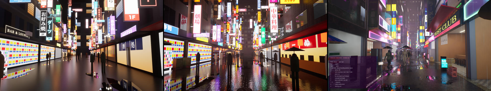
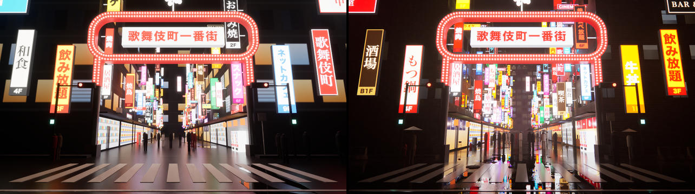
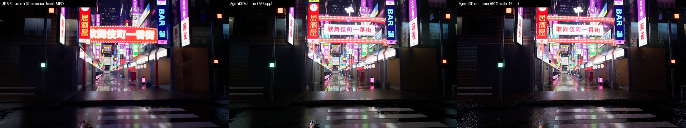
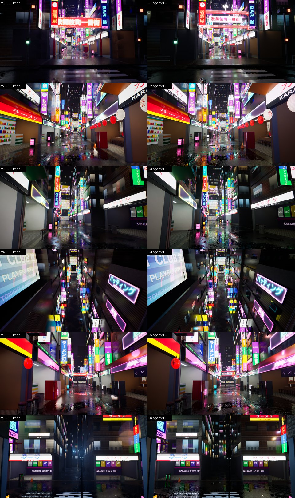
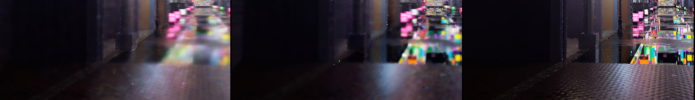
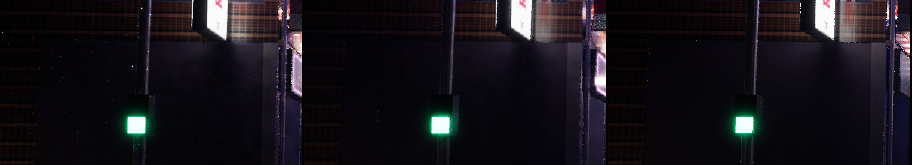

# Feature parity with the UE 5.8 Kabukichō session

A second session built the same brief ("an interactive Kabukichō night scene, highest visual quality") directly in
Unreal Engine 5.8 (`ue5-kabukicho-night-scene` branch, `kabukicho-ue5/`), and reached clearly richer detail than our
first Kabukichō Night. This note records why, and what our engine + authoring skill gained to close the gap.

## What actually produced the detail

The Epic `unreal-engine-skills-for-claude-code` plugin was installed, but its `unreal-mcp` skill only covers MCP
plumbing (tool discovery, save/compile/PIE safety); it carries no art, material or lighting guidance, and the in-editor
Agent Skills (`material_basics`, `default_outdoor_lighting`) were never loaded. The quality came from engine
capabilities the agent drove with its own Python + Custom-HLSL:

| UE technique (kabukicho-ue5) | Effect | Our engine before |
|---|---|---|
| ~150 unique full-res sign textures (Pillow + Hiragino), baked neon glow, light-box diffuser falloff, avg glow colour per sign | Crisp, varied signage; each sign tints its spill light | one shared 2048² atlas; all textures forced to one size |
| 29 Poly Haven CC0 PBR sets (2k diff/nor/rough), world-aligned dominant-axis planar mapping, wrap tiling | Micro-detail on every surface at any scale | mesh UVs only, no tiling of atlas sub-rects, no external texture assets |
| Custom-HLSL facade: procedural windows (per-cell hash, whole-floor lighting, fake room interiors, mullions, glass) + grime | Thousands of believable lit windows for free | windows painted into a stretched texture |
| Global wetness + puddle mask, near-mirror puddles (roughness 0.015), damp rims, animated rain-ripple normals | The wet-street look | clearcoat plane + black puddle decals |
| Emissive animation: flicker, blink, UV pan (LED marquees), LED pixel grid on screens | Living signage | static emission |
| 146–312 coloured point / spot / rect lights spilling shop and sign light | Coloured light pools on the street | every analytic light costs a shadow ray per bounce (O(N)) |
| Exponential height fog + volumetric fog (per-light scattering) | Haze, light halos, depth | fog ignored by the renderer |
| Night sky dome (gradient + light-pollution glow + clouds) as real-time sky light | Readable silhouettes against the sky | uniform sky colour |
| Post: histogram + local auto exposure, bloom size ×5, chromatic fringe, grain, vignette, white balance, saturation / contrast, shadow / highlight gains | Filmic night grade | UE filmic tonemap, bloom, vignette only |
| 34 Poly Haven props (AC units, poles, cables, bags, crates, hydrants, shutters, stools…), 351 meshes; recessed shop interiors | Street clutter and depth | boxes and cylinders |
| Camera-wrapped rain streaks (16k WPO quads), animated mannequin crowd with umbrellas, synthesized audio | Motion and atmosphere | none |

It ran at 35–43 fps (1080p, TSR 60 %) on the M5; our first version ran at 60 fps.

## What we added

Engine (renderer + DSL; at the time also the scene IR and its UE adapter, both since removed, see [RUNTIME.md](RUNTIME.md)):

1. **Textures** (`renderer/src/texpack.rs`): any number and size of textures shelf-packed into 4096² array pages with
   wrapped / clamped 16 px gutters and a 5-level box mip chain (rects aligned so mips never mix textures); a per-texture
   table drives manual wrap / clamp; ray-cone LOD (Akenine-Möller 2019) picks the mip per hit; `texture.offset`;
   alpha-cutout materials (`alphaTest`) through four BLAS groups (opaque / cutout × shadow / no-shadow) with ray-query
   candidate confirmation, and the same test in the software BVH. Pages are cached across live re-uploads.
   Static glTF models are instanced (hardware RT; `scene::Instance`): each unique mesh's triangles once in model
   space with one BLAS (opaque geometry + cutout geometry), one TLAS instance per placement (transform, shadow mask,
   custom data = instance record), shading transforms the hit triangle; glass, emissive and material-function
   triangles are flattened per placement (shadow rays, emitter sampling), animated / movable / mirrored models
   entirely. `THREERT_INSTANCING=0` flattens everything, `=log` lists what each model instances.
   `node tools/check-instancing.ts` renders instanced cutout props (scaled and not) instanced, flattened and through
   software traversal, and fails when they differ (crops: `docs/img/bugbot-instanced-cutouts.jpg`).

Items 2–5 began as built-in material fields in the path-tracing kernel; since 2026-11-06 they are material
functions of the standard library (`packages/scene/src/materials.ts`, [MATERIAL_FUNCTIONS.md](MATERIAL_FUNCTIONS.md)),
the same code moved line for line, and the kernel has none of it.

2. **World-space mapping**: `SurfaceMaterial({ worldScale })` (dominant-axis planar, metres per repeat) for every map,
   with the matching tangent frame for normal maps; `TriplanarMaterial`, `FacadeMaterial` and `WetGroundMaterial`
   map by world position too.
3. **Wetness**: `scene.wetness` / `scene.rain`; `SurfaceMaterial`'s `wet` (Lagarde: darker diffuse, glossier,
   flattened normals), `puddles` (noise height field + darker texels flood first; mirror water, roughness 0.02),
   animated rain ripples (expanding rings in a jittered grid), procedural `grime` (blotches + vertical streaks);
   `WetGroundMaterial` (UE port: puddle mask).
4. **Procedural facade windows**: `SurfaceMaterial`'s `windows` (`facadeWindows()` helper): frames, mullions /
   transoms, glass, lit rooms with interior mapping (back wall + furniture silhouettes, ceiling light panel, side
   walls, floor), blinds, warm / fluorescent palettes, whole floors on or off together; `FacadeMaterial` (UE port).
5. **Emissive animation**: `NeonSignMaterial` flicker (drop-outs + 113 Hz buzz), blink and scroll (marquees),
   `LightPanelMaterial` blink, `LedScreenMaterial` pixel grid and plasma; a scene clock in the live renderer, and a
   short temporal history on pixels whose material function emits (G-buffer flag) so animation does not smear.
6. **Many lights**: local lights beyond 8 are resampled (RIS, 8 candidates at the camera hit, 3 deeper, cheap
   cosine-weighted target) with one shadow ray; emissive NEE samples the emissive map, so signs spill their own
   colours; sky NEE is skipped when the sky is negligible next to the emitters (night streets).
7. **Fog**: UE-style exponential height fog (analytic transmittance on every path segment, ambient inscattering,
   start distance, max opacity) and volumetric single scattering on camera rays (optical-depth distance sampling,
   HG phase, RIS over local lights and over 4 emitter candidates, firefly clamp, half the pixel tiles per sample).
8. **Night sky**: `SkyGradient` (zenith / horizon / ground, light-pollution glow, cloud layer lit from below), baked to
   the environment map so it lights the scene.
9. **Post**: UE CombineLUTs-style grading baked into the tonemap (white balance via Bradford from the D illuminant,
   saturation, contrast, shadow / highlight gains), bloom threshold + size scale, chromatic aberration (scene fringe),
   film grain — offline and live.
10. **Assets**: `tools/fetch-polyhaven.ts` (CC0 texture sets + models packed to GLB, curated street set), and
    repo-relative asset paths the renderer reads from the asset root (render nodes fetch the files they miss).
11. **Kernel specialisation**: the path tracer is compiled per scene feature mask (`override FEAT`), so scenes that do
    not use a feature pay nothing for it (all five reference scenes are as fast as before or faster).

Authoring: `.claude/skills/threert-scene-authoring/` — the workflow and art checklist that the UE session applied
implicitly (reference photos → material system first → lighting → atmosphere → clutter → review loop →
performance pass), with value tables, a failure-pattern table and measured feature costs, written for our DSL.

## Results

Kabukichō v2 (`games/kabukicho`) uses all of it: Poly Haven asphalt / bone pavers / ten facade sets in world mapping,
procedural windows on every building, rain with puddles and ripples, height fog with volumetric halos, the night sky,
21 coloured shop spill lights, flickering / blinking signs, an LED screen, umbrellas, 19 kinds of Poly Haven props
(AC units, crates, bags, chairs, hydrants, barriers, manholes …) and the session's grade. 477 nodes, 1.16 M triangles,
97 textures, 22 k emissive triangles.

UE references of the same v2 IR (extended adapter: Custom-HLSL master mirroring the WGSL material functions, gradient
sky dome, fog with an exact unit mapping — UE's FogDensity / falloff are per-cm base-2 terms, see `setup_fog`):
mean ΔE / SSIM of the native offline render vs UE Lumen 9.60 / 0.738, vs the UE Path Tracer 10.34 / 0.835 (Lumen vs
the Path Tracer: 12.83 / 0.667). Remaining UE-side gap: Lumen's volumetric fog only scatters punctual lights, so the
glow of emissive signs in the haze is missing there.

Live viewport (M5, 1280×720, 1 spp/frame + temporal + denoise): 23.8 ms/frame (~42 fps) vs the UE session's
35–43 fps at 1080p with TSR at 60 % (~0.75 Mpixel shaded; ours shades 0.92 Mpixel per frame). Feature costs are in the
skill's [performance table](../.claude/skills/threert-scene-authoring/references/review-and-performance.md). The five
reference scenes are unchanged against the UE5 references (same ΔE / PSNR / SSIM; glb-asset improves with mip-mapped
textures, SSIM 0.915 → 0.920) and render 8–30 % faster offline.

## Round 2: converge on the UE level itself (ground truth)

Round 1 compared each feature with a UE render of *our* IR (through the adapter). Each feature matched UE, yet native
UE content still looked clearly better. Without a fixed target the visual improvements did not converge. Round 2
changes the reference. The acceptance image is now the UE session's own level, rendered by UE with its own camera,
and our job is to reproduce that content in ThreeRT. The IR → UE adapter is no longer extended.

**Route.**

1. **Ground truth from the UE project** (a scratch copy; the user's project is never touched).
   - `ue5/scripts/ue_dump_level.py` dumps the level to JSON: 2691 actors, transforms, meshes, material-instance
     parameters, 147 lights, fog, post-process overrides and the sky light.
   - `ue5/capture.ts` + `ue5/scripts/ue_capture.py` render fixed cameras with Movie Render Queue, either as display
     PNGs (Lumen, authored auto exposure) or as radiometric linear EXRs (tone curve, bloom and local exposure off) at
     a fixed EV.
2. **1:1 port of the content generator.**
   - The session built its level with a seeded Python script, so `games/kabukicho/street.ts` ports it line for line.
     `PyRandom` reproduces CPython's `random` exactly (MT19937, `uniform` / `choice` / `choices` / `shuffle` /
     `sample`).
   - The vendored sign and mask generators (`tools/kabukicho/`) produce byte-identical textures.
   - `tools/kabukicho/verify-port.py` checks every actor's position, rotation, scale and material against the dump.
   - Only the gate is our own (see the brief).
3. **Material functions**, our Custom-HLSL equivalent ([MATERIAL_FUNCTIONS.md](MATERIAL_FUNCTIONS.md)). The session's
   nine master materials (facade, ground, surface, paint, sign, screen, emissive, shop window, road paint) are WGSL
   bodies with the same parameters and hashes, evaluated in UE world space (`ue_pos`). The material system becomes
   code plus a small fixed contract, not a growing list of built-in fields. Round 1's built-in UE-specific fields were
   reverted.
4. **UE semantics where the port exposed differences**, all generic engine fixes:
   - rect lights (luminance = cd / area, one-sided, barn doors, invisible to the camera);
   - per-light volumetric scattering and specular scales;
   - node *Power*, the UE material parameter gameplay animates;
   - object pivot and bounds in materials;
   - fog unit conversion (`ExponentialHeightFog.fromUnreal`) and volumetric extinction scale / albedo / distance;
   - the night-sky material (gradient exponent, glow band, cloud mask projection);
   - UE's eye-adaptation histogram, including outlier removal and the *legacy* luminance-range semantics this project
     uses;
   - UE local exposure and per-channel grading;
   - the UE bloom threshold formula.

   One gotcha: `unreal.Color(r, g, b)` stores B, G, R, so the session's lights are red/blue swapped in its own level.
   We reproduce what UE renders, not what the script meant.
5. **Same-camera convergence loop.**
   - `tools/kabukicho/views.py` renders our scene at the six UE cameras (`threert-render render --camera`).
   - `threert-render compare` gives display ΔE / SSIM; `compare-hdr` gives radiometric ratios with heat maps.
   - Every change is measured against the six views, and the loop decides what to fix next.

**Convergence** (display, vs UE Lumen with auto exposure, 1280×720, mean ΔE76 / SSIM):

| iteration | v1 | v2 | v3 | v4 | v5 | v6 |
|---|---|---|---|---|---|---|
| port, round-1 renderer (exposure / units as before) | – | 20.04 / 0.537 | – | – | – | – |
| + UE auto / local exposure, rect lights, fog units, sky | 11.34 / 0.737 | 12.30 / 0.753 | 10.82 / 0.754 | 9.33 / 0.768 | 11.23 / 0.768 | 13.15 / 0.674 |
| final offline (256 spp, OIDN) | 11.28 / 0.734 | 12.46 / 0.747 | 11.06 / 0.745 | 10.46 / 0.756 | 11.38 / 0.763 | 13.22 / 0.669 |

Radiometrically (linear EXR at EV 1.5 vs our raw HDR) the luminance ratio is 0.86–1.04 per view and the median
per-pixel log₂ ratio ≈ 0, so radiance parity is good. The remaining display error is dominated by content and
sampling differences: our own gate replaces UE's, TSR is softer, ripple contrast differs, and UE's facades are darker
under its software Lumen GI. v1 is 1.19× brighter, mostly because the gate's histogram contribution differs.

**Real time (60 fps).** The port has 4.0 M triangles, 147 lights and 78 k emissive triangles. It ran at 36 ms/frame
in the live viewport. Four generic changes brought it to 60 fps and to the offline look:

- **Render scale + temporal upsampling** (UE TSR / screen percentage).
  - Samples are traced at the internal resolution with their sub-pixel jitter recorded. The temporal pass splats them
    onto the output grid (Gaussian on the jittered distance, restricted to the nearest sample's surface) and
    accumulates history by sample weight.
  - History is validated against the depth range of the neighbourhood, so edges don't flicker as the jitter flips
    the surface.
  - Texture mips use the output resolution.
  - `--scale 0.6` or `auto`: dynamic resolution (UE `r.DynamicRes`, 50–100 %) is the default in the viewer and the
    playground. The frame governor lowers the scale before trading bounces.
- **UE Standard bloom in the live path**: six Gaussian stages on a 1/4–1/64 chain, as offline, replacing a single
  blur.
- **Directly seen emission is kept out of the denoiser.** The path tracer outputs the camera-ray emission separately;
  it is accumulated in its own history and added back after the à-trous filter. Signs and screens previously lost
  their text: they are short-history animated pixels where the filter is strongest, and their base colour is a poor
  demodulation albedo.
- **Eye-adaptation speeds** come from the scene (UE PPV speed up / down).

| v1, 1280×720, M5 | GPU ms / frame | vs UE Lumen (ΔE / SSIM) | vs ThreeRT offline |
|---|---:|---|---|
| live before this round (100 %) | 36.2 | 12.05 / 0.587 | 7.72 / 0.739 |
| live now, 100 % | 34–35 | 10.68 / 0.649 | 5.54 / 0.795 |
| **live now, 60 % (TSR-style)** | **15.8–16.7** | **10.38 / 0.689** | **5.12 / 0.856** |

At 60 % the upsampled image is closer to UE than our 100 % render: UE's own capture is TSR-reconstructed. In the
playground the Kabukichō tour now runs at a median 60.1 fps (dynamic resolution); the previous Kabukichō ran at 41.3.
The five reference scenes keep their offline images bit-identical and offline trace time unchanged. Live, their
quality improves (glb-asset SSIM 0.920 → 0.950, neon-reflections first frame 0.854 → 0.913) for about +1 ms per frame
(bloom chain 0.3 ms).

**Next.**

- ~~Scene code executing on the render node.~~ Done, with the scene IR removed entirely (the code drives the
  engine API; the world is the game state; render jobs carry that state), locally and in the cloud stack:
  [RUNTIME.md](RUNTIME.md).
- Running the denoiser at the internal resolution (2.6 ms at output resolution today).
- Cheaper material functions at indirect hits.
- A world-space radiance cache for disocclusions.

## Round 3: the live viewport in motion and after lighting changes

Static convergence was measured in round 2. Two complaints remained in real use: reflections smeared while moving, and
the street turned to noise after lights switched off, which UE does not show. Both are now measured against a reference
(`tools/bench-temporal.ts`). The reference is the same renderer, same pose and same state, converged for 1024 frames.
The test frames are:

- frames during a 2.5 m dolly with a 12° turn;
- a frame 0.5 s after the camera stops;
- frames 0.3 / 1 / 2 / 4 s after closing time switches half the sign groups off, with the frame script's flicker.

`THREERT_PROFILE=1` prints GPU time per live pass.

**Causes and fixes.**

1. **A black-frame bug.** After closing time or a camera jump, the whole frame went black and stayed black.
   - Directly seen emission is accumulated in f16 and subtracted from f32 lighting. That rounded below zero on
     emitters.
   - The negative mean made the denoiser's edge-stop sigma negative. `exp` overflowed and produced NaN, and bloom
     spread one NaN pixel over the whole frame.
   - Fix: the lighting is clamped at zero, the denoiser output falls back to its input when non-finite, and exposure
     and bloom ignore non-finite pixels.
2. **Smeared reflections.** The denoiser demodulated *all* lighting by the base colour and blurred it, so a wet
   street's reflections (asphalt base ≈ 0.05) became large coloured blobs. History was also reused by surface
   reprojection, but reflections move with the view.
   - The path tracer now outputs diffuse and specular lighting separately, with first-hit roughness and the
     distance to the reflected hit.
   - Specular history is reprojected through the planar-mirror virtual point for smooth surfaces. While moving, it is
     clamped into the current neighbourhood's range.
   - The specular filter is not demodulated, and its radius scales with roughness, so mirrors stay sharp.
   - The sky seen directly joins the emission channel (never denoised).
3. **Noise after lighting changes.**
   - *Global cap.* Every power edit capped *all* history at 8 frames. During a 3 s flicker sequence the whole image
     sat at a ~1-spp average.
     - Now a lighting edit applies a mild global cap of 16.
     - For 45 frames after an edit, the temporal pass looks for local change (anti-lag): the 3×3 same-surface fast
       and slow means of the diffuse luminance are compared, and the history restarts only where the lighting really
       changed. Running it all the time made noise look like change and reset histories at random.
   - *Diffuse temporal moments.* The pixels' temporal moments now drive the denoiser (variance-guided edge-stop) and a
     firefly limit. The limit only cuts what would show as a sparkle: (sample − mean) / frames > ½ mean. Long histories
     stay unbiased; the converged image keeps luminance ratio 1.00 against the previous renderer.
   - *Exposure-relative clamp.* The per-sample ceiling follows the *current* GPU exposure. It used to follow the
     load-time exposure guess, which let sparkles through once the eye adapted to a darker street.
4. **Less noise at the source, UE-style direct light.** Lights are ordered directional → unshadowed local → shadowed
   local.
   - Where the camera sees a surface, directly or in a mirror-like reflection:
     - unshadowed local lights (143 of Kabukichō's 147) are evaluated exactly, like UE's deferred lights;
     - shadowed ones are evaluated exactly with a shadow ray each when few;
     - emitters are chosen by RIS over 6 candidates from the power CDF, weighted by luminance × geometry term.
   - The MIS split with BSDF sampling is unchanged, so the estimator stays unbiased. Offline, the reference scenes
     keep luminance ratio 1.000 (noise-level differences only).

**Measurements** (Kabukichō, M5, 1280×720, mean ΔE / SSIM vs the converged reference):

| frame | before, 100 % | now, 100 % | before, dynamic | now, dynamic |
|---|---|---|---|---|
| moving (frame 20 / 59) | 5.23 / 0.789 · 5.92 / 0.758 | 5.21 / 0.799 · 6.38 / 0.751 | 7.45 / 0.731 · 9.36 / 0.679 | 8.15 / 0.717 · 10.06 / 0.663 |
| 0.5 s after stopping | 5.10 / 0.755 | 5.38 / 0.784 | 7.06 / 0.745 | 7.94 / 0.733 |
| closing + 0.3 s | 7.33 / 0.720 | 7.24 / 0.781 | 8.00 / 0.741 | 8.83 / 0.747 |
| closing + 1 s | 4.65 / 0.732 | 4.41 / 0.832 | 4.55 / 0.789 | 5.13 / 0.807 |
| closing + 2 s | 4.77 / 0.730 | 3.95 / 0.838 | 4.57 / 0.792 | 4.18 / 0.829 |
| closing + 4 s | 6.38 / 0.714 | 3.90 / 0.843 | 4.05 / 0.806 | 3.77 / 0.836 |

ΔE scores blur better than noise, so "before" keeps its numbers while smearing reflections: the crops show the
difference. vs UE Lumen, view v1, live at 60 % after 128 frames: ΔE 10.44 / SSIM 0.677 before, **10.11 / 0.732** now.

**Cost.** At 60 % render scale the frame went from 16.3 to 21.2 ms.

| pass | ms |
|---|---:|
| trace | 13.8 |
| temporal | 1.7 |
| specular filter | 1.4 |
| diffuse à-trous | 3.5 |
| post | 0.5 |

The output-resolution passes cost the same at any render scale. To hold 60 fps, dynamic resolution settles near 50 %
(the viewer then trades bounces). This is why the dynamic-resolution numbers trail the 100 % ones. Running the
temporal and denoise passes at the internal resolution, upsampling last, is the next lever.
