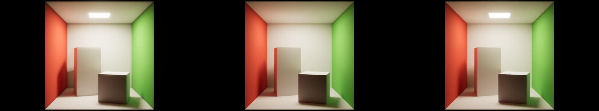
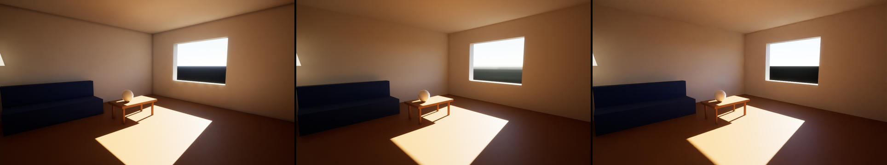
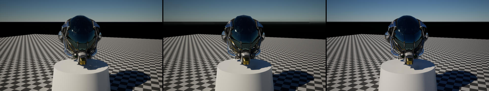
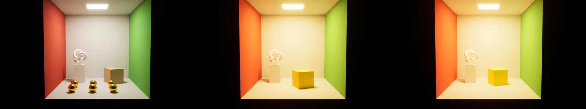
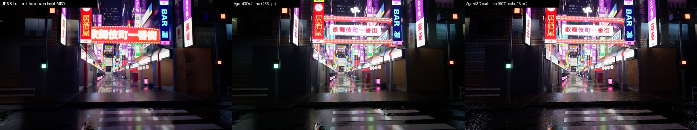

# ThreeRT: UE5-fidelity rendering without UE5 — evaluation report

> Split note (2026-11-10): this engine was extracted from `taichi-dev/serverless-agent-test` (main `42a51d6`). The serverless parts this document describes — `cloud/` (gateway, rooms, render pool), `render-node/`, `render-container/` and the deploy scripts — stay in that repository.

All numbers were measured on 2026-11-03 on a MacBook Pro (Apple M5, 10-core GPU, Metal 4, 32 GB) with UE 5.8.4,
1280×720 output, unless stated otherwise. Reproduce with the commands in [Reproduce](#reproduce).

## 1. Reference scenes

Five scenes written with the Three-like DSL (`scenes/*.ts`) cover the `cinematic` preset's focus areas:

| scene | covers |
|---|---|
| `cornell-box` | GI color bleeding, area-light soft shadows, visible emitter |
| `material-grid` | PBR: dielectric white / red and gold metal × roughness 0.05–0.9; physical sky + sun; soft sun shadows |
| `sun-room` | interior GI: sun patch through a window, sky light through an opening, multi-bounce, emissive lamp |
| `neon-reflections` | reflections (glossy floor, chrome, gold, copper), emissive neon + bloom, spot lights, low-key exposure |
| `glb-asset` | external textured GLB (DamagedHelmet: base color, ORM, normal, emissive) + generated checker texture |

Each scene was compiled to a scene IR (since removed: scene code now drives the renderer's engine API directly, see
[RUNTIME.md](RUNTIME.md)) and rendered three ways:
**UE5 Lumen** (MRQ, cinematic scalability, Lumen HWRT + hit-lighting reflections, VSM, TSR 16 temporal samples, 64 warm-up frames),
**UE5 Path Tracer** (MRQ, 1024 spp, denoiser on; ground truth), and the **native renderer** (`threert-render`, OIDN).

Strips below: UE Lumen | UE Path Tracer | native @ 32 spp.







## 2. Quality vs UE5

Metrics: mean CIEDE76 ΔE / PSNR dB / SSIM against each UE5 render (ΔE < 2.3 ≈ just-noticeable difference).

| scene | native 32 spp vs UE PT | native 256 spp vs UE PT | **UE Lumen vs UE PT** | native 32 spp vs UE Lumen |
|---|---|---|---|---|
| cornell-box | **0.99** / 32.7 / 0.990 | 0.94 / 32.8 / 0.991 | 3.27 / 26.6 / 0.976 | 2.71 / 28.5 / 0.983 |
| material-grid | 1.96 / 36.1 / 0.990 | 1.96 / 36.1 / 0.990 | **1.44** / 33.7 / 0.988 | 2.32 / 33.8 / 0.985 |
| sun-room | **3.39** / 26.9 / 0.980 | 3.02 / 26.9 / 0.981 | 4.22 / 26.3 / 0.978 | 4.08 / 28.6 / 0.974 |
| neon-reflections | **2.12** / 28.0 / 0.929 | 2.05 / 28.2 / 0.932 | 2.31 / 24.4 / 0.896 | 2.87 / 25.1 / 0.889 |
| glb-asset | 4.28 / 26.5 / 0.914 | 4.21 / 26.6 / 0.915 | **1.85** / 29.7 / 0.936 | 3.98 / 28.4 / 0.951 |

Findings:

* Against UE's own ground truth (Path Tracer), the native renderer at 32 spp is **as close as or closer than UE Lumen on 3 of 5
  scenes** (Cornell, sun room, neon). Lumen under-lights spot-lit and indirectly lit regions (neon luminance ratio 0.66 vs 0.98 native).
* `glb-asset` residual is aerial-perspective haze / sky tone in UE PT and distant-texture filtering (UE mip-maps; native supersamples), not material error.
* UE parity required matching engine details found by reading the 5.8 source: rect lights emit `brightness/(0.5·W·H)`
  (adapter sets nits/2); DefaultLit's multiscatter compensation is effectively off (fit k = 0 against UE PT; native k = 1
  passes the white furnace test at 0.97–1.03); UE's Gaussian bloom, `FilmToneMap` + gamut expansion + blue correction, and
  cos⁴ vignette are ported exactly; sun illuminance uses UE's 15-step ground-level transmittance.
* Each discrepancy was isolated with A/B renders against the UE path tracer, e.g. Cornell ΔE 8.0 → 0.93 after the rect-light fix.

## 3. Speed and cold start

| | cold start → first screenshot | per frame (warm) |
|---|---|---|
| UE5 editor + MRQ Lumen (warm DDC/shader cache) | ~35 s | 6.4–11.0 s |
| UE5 editor + MRQ Path Tracer 1024 spp | ~112 s | 64–142 s |
| native, `preview` (32 spp + OIDN) | **0.29–0.31 s** (process launch incl. GPU init 11 ms; 3.7 s on first launch after a rebuild) | **0.24–0.74 s** |
| native, `cinematic` (256 spp + OIDN) | — | 1.2–4.6 s |

GPU throughput (warm `serve` process, 1280×720, median of 3, paths/s = pixels × spp / trace time):

| scene | triangles | HW ray query (Metal RT) | software BVH | speed-up | preview fps (HW) |
|---|---:|---:|---:|---:|---:|
| cornell-box | 86 | 219 M | 104 M | 2.1× | 4.1 |
| material-grid | 217 730 | 185 M | 54 M | 3.4× | 2.7 |
| sun-room | 6 400 | 54 M | 18 M | 3.0× | 1.4 |
| neon-reflections | 61 498 | 97 M | 22.5 M | 4.3× | 2.4 |
| glb-asset | 15 838 | 182 M | 61 M | 3.0× | 2.0 |

The same binary runs on Linux/Vulkan. In the `render-container` image on Mesa lavapipe (CPU, no GPU) it renders `cornell-box`
16 spp + OIDN at ΔE 1.02 vs UE PT; that run was emulated (amd64 on Apple Silicon), so CPU timings are not representative.

## 4. Cost per screenshot

`node tools/cost-model.ts` (control plane priced from Cloudflare list prices; GPU time from the M5 measurements above,
used as an upper bound for discrete RT GPUs; 50 % pool utilization):

| backend | preset | frame (s) | $/screenshot incl. control plane | screenshots / $1 |
|---|---|---:|---:|---:|
| RTX 4090 @ $0.48/h | preview | 0.46 | $0.00013 | 7 500 |
| NVIDIA L4 @ $0.80/h | preview | 0.46 | $0.00021 | 4 700 |
| RTX 4090 @ $0.48/h | cinematic | 2.29 | $0.00062 | 1 600 |
| NVIDIA L4 @ $0.80/h | cinematic | 2.29 | $0.0010 | 970 |
| UE5 MRQ Lumen on L4 @ $0.80/h (frame time only, excl. 35 s editor start) | cinematic | 9.4 | $0.0042 | 240 |

Control plane (Workers + Durable Objects + Dynamic Worker + R2) is ≈ $0.00001 per screenshot, i.e. < 10 % of GPU cost.

## 5. Gameplay runtime and Cloudflare infrastructure (verified locally)

Agent-written game (`cloud/test/fixtures/coin-room.game.ts`): DSL scene + `click` / `scored` handlers using `tx.decide`,
nested `tx.attempt`, `tx.emit`, `tx.random` and `tx.requestRender`. `node cloud/test/e2e-local.ts` drives the full loop
against `wrangler dev` (workerd: Durable Objects, R2 and the Worker Loader emulated locally) with the real GPU render node:

| step | local timing (M5) |
|---|---|
| `POST /v1/code` (TS strip 5 ms, R2 store, Dynamic Worker isolate load 3 ms) | 12 ms |
| `POST /v1/rooms` (setup in sandbox + geometry GLBs to R2) | 14 ms |
| 12 concurrent click events (6 coins, 3 duplicates → `decide` failures, crate, bad target) | 24.6 ms wall |
| sandbox execution per event | p50 2 ms, max 4 ms |
| OCC: 26 concurrent events → 15 conflict retries, every coin collected exactly once | ✓ |
| replay + determinism verify (26 events re-executed in a fresh isolate, 0 mismatches) | 9.5 ms |
| render job, cold node cache (queue / run / total), 640×360, 16 spp | 102 / 147 / 249 ms |
| warm loop: event → commit → render request → PNG available | **147 ms** |
| node timeout → job re-dispatched to another node (attempts = 2); provisioner hook fired once | ✓ |

The Linux image (`render-container/`, lavapipe CPU + OIDN) also joins the pool as an external node
(`node cloud/test/linux-node-smoke.ts`): container start → PNG in 5.5 s (amd64 emulated on Apple Silicon).

Isolation: agent code runs only in Dynamic Workers created with `globalOutbound: null` (outbound `fetch` is rejected) and a
CPU limit; `Math.random` / `Date.now` are replaced with seeded / event-time versions so handlers replay deterministically.

### Production (deployed 2026-11-03, `https://agent3d-gateway.meshy-730.workers.dev`, behind Access/Okta)

`node cloud/test/demo-prod.ts` runs the same agent-written game against Cloudflare with the M5 laptop connected as the
GPU render node (WebSocket to the RenderPool DO). Client and node run on the same laptop, so the times include its WAN
round trips to the Cloudflare edge:

| step | time |
|---|---|
| `POST /v1/code` (R2 store 904 ms, Dynamic Worker load 544 ms) | 1.7 s |
| `POST /v1/rooms` (cold Durable Object + setup in Dynamic Worker 515 ms + blobs to R2 1.4 s) | 2.7 s |
| `GET /v1/rooms/:id` (warm DO) | 312 ms |
| 12 concurrent clicks: 9 committed, 3 `decide` failures, 3 OCC retries | 1.4 s wall (p50 1.1 s) |
| replay + determinism verify, 18 events in a fresh isolate, 0 mismatches | 588 ms |
| screenshot 960×540 32 spp, cold node cache: blob fetch 1.8 s + **render 0.74 s** + PNG upload 2.6 s | 5.0 s |
| screenshot 960×540 128 spp `cinematic`, warm cache: **render 0.39 s** (trace 0.30 s) + upload 1.8 s | 2.4 s |

GPU work is 0.1–0.7 s per screenshot. The rest is transfer over the laptop's WAN link, which a datacenter GPU node next to
Cloudflare would avoid.



## 6. Real-time native viewport (60 fps) vs UE5 Lumen

`threert-render play <bundle>` renders straight to a native window (winit + wgpu
swapchain, no browser, no streaming). It follows the same idea as UE5's real-time path with hardware RT: every frame
traces 1+ spp with hardware ray queries (primary visibility, GI, soft shadows, reflections; 4 bounces + Russian
roulette), reprojects and accumulates history validated per pixel by depth/normal (TSR/Lumen-style temporal reuse),
denoises with an edge-avoiding à-trous filter (two extra wide passes where history is short, the role Lumen's radiance
cache plays; directly seen emission bypasses it), and applies UE's post chain (UE auto / local exposure, six-stage
bloom, cos⁴ vignette, filmic tonemap through a 32³ log LUT). Below 100 % render scale the temporal pass also upsamples
jittered samples to the output (TSR-style). Dynamic resolution (50–100 %) and then samples per frame adapt to the
GPU budget. Scene changes from the game keep history (geometry stays valid) and cap it briefly so
lighting changes converge within a few frames.

`node tools/bench-live.ts` (1280×720, M5): frame `k` frames after a full history reset, vs the UE5 references.
`k = 1` is a fresh disocclusion / camera cut; while orbiting, reprojected history is typically 8–16 frames.

| scene | GPU ms / frame | k = 1 vs Lumen | k = 16 vs Lumen | k = 256 (~4 s still) vs Lumen | k = 256 vs UE Path Tracer |
|---|---:|---|---|---|---|
| cornell-box | 10.9 | 4.52 / 0.952 | 3.58 / 0.962 | 3.47 / 0.971 | **1.35 / 0.981** |
| material-grid | 11.2 | 2.72 / 0.964 | 2.37 / 0.968 | **2.37 / 0.972** | 2.08 / 0.974 |
| sun-room | 17.3 | 14.00 / 0.662 | 6.10 / 0.678 | 4.22 / 0.933 | 4.36 / 0.934 |
| neon-reflections | 12.8 | 1.81 / 0.913 | 2.45 / 0.861 | 2.73 / 0.862 | 2.35 / 0.882 |
| glb-asset | 12.0 | 5.42 / 0.873 | 4.19 / 0.945 | 4.10 / 0.950 | 4.39 / 0.914 |
| Kabukichō (UE port, 60 % scale) | 15.8–16.7 | 11.91 / 0.610 | 10.84 / 0.637 | 10.38 / 0.689 | – |

(mean ΔE76 / SSIM.) Findings:

* All scenes run at 60 fps at 1280×720 on the M5 (sun-room, 17 ms at 100 %, and the Kabukichō port, 34 ms at 100 %,
  through dynamic resolution; §8).
  With the game host driving it, frame rate stays at 60 fps (median) while transactions hot-reload the scene.
* Holding still, the real-time path converges to the same distance from Lumen as the offline renderer (ΔE 2.4–4.9 vs
  2.3–4.1 offline) and is closer to UE's path tracer than Lumen itself on cornell-box / neon.
* Weak spot: indirect-dominated interiors right after a disocclusion (sun-room k = 1: SSIM 0.62). Lumen's radiance
  cache keeps those stable; here they need ~0.25–1 s of history. A world-space irradiance cache is the next step.

## 7. Playground client (macOS native, PocketJS UI)

`playground/` is a native editor for manual acceptance: one winit window and one wgpu 30 device shared by the
PocketJS UI (Solid TSX compiled to a QuickJS bundle + pak; laid out and drawn by PocketJS's wgpu renderer, recorded
into the frame's command encoder) and LiveCore, whose output is composited inside the UI layout through a PocketJS
compositor surface. The opened scene / game runs in the host's embedded JS runtime (as on a render node); a Node
backend (`tools/playground-backend.ts`) keeps the catalog, the editor model (selection, details, undo) and the Play
flow, and edits apply to the live scene (parameters in place, structure by an in-memory rebuild; opening the 4
M-triangle Kabukichō port takes ~5.8 s). Measured (`--tour`, M5, 2844×1768 Retina window): 60 fps median on all seven scenes (Kabukichō: 60.1 with dynamic resolution); UI turn
0.01–0.1 ms; `--uitest` drives real pointer input through 14 checks at a 1245×829 window (content browser + scene menu, outliner, scrub edits, undo,
checkbox, compare, view mode, viewport picking, Play / Stop, in-game clicks) — 14/14 pass.

## 8. Kabukichō Night: a procedural, photo-referenced interactive scene

`games/kabukicho/kabukicho.game.ts` is an agent-style game written only against the Three-like DSL and the
transactional gameplay API: the Kabukichō Ichiban-gai gate (swept red frame, ~330 marquee bulbs, the
「歌舞伎町一番街」 light box), ~24 buildings, storefronts, awnings, lanterns, ~120 signs (stacked tategaki blade signs,
light boxes, fascia boards, rooftop billboards, an LED screen), the crossing with signals, vending machines, lamps,
cables, pedestrians with umbrellas and a taxi. Art direction follows night photos of the gate (Wikimedia Commons, e.g.
Basile Morin's featured picture, CC BY-SA 4.0; not redistributed here). Sign typography (Hiragino, generic shop
names), storefronts and the vending machine come from one 2048² atlas drawn by headless Chrome
(`tools/kabukicho-atlas.ts`, embedded in the game). Interaction (Play): click a sign / the gate / lanterns / lamps to
switch them, a vending machine to buy a drink, the taxi to drive it; `rain` (wetness + rain on / off), `lights`
(closing time) and `viewpoint` handlers. Each click is a transaction on the game state; the frame script updates the
scene.

**v2 (engine parity, §9)** rebuilt the look with the new engine features: Poly Haven CC0 asphalt, bone pavers and ten
facade sets in world mapping, procedural lit windows on every building, rain (wet ground, puddles, ripples), height fog
with volumetric halos, a night sky with light-pollution glow and clouds, 21 coloured shop spill lights, flickering /
blinking signs, 19 kinds of Poly Haven street props and the UE session's grade. 477 nodes, 1.16 M triangles, 97
textures, 22 k emissive triangles.

| 1280×720, M5 (v2) | mean ΔE / SSIM vs UE5 Lumen | vs UE5 Path Tracer | time |
|---|---|---|---|
| UE5 Lumen (MRQ cinematic) | – | 12.83 / 0.667 | 18.0 s / frame (+58 s level build) |
| UE5 Path Tracer (1024 spp) | 12.83 / 0.667 | – | 181.9 s / frame |
| ThreeRT offline (256 spp + OIDN) | **9.60 / 0.738** | **10.34 / 0.835** | 4.7 s at 128 spp |
| ThreeRT real-time, 256 frames still | 10.36 / 0.643 | 11.95 / 0.621 | 23.2 ms GPU / frame |
| ThreeRT real-time, 1 frame (disocclusion) | 11.70 / 0.589 | 15.40 / 0.403 | |

The UE references are renders of the same IR by the extended adapter (since removed; every v2 feature was mirrored in UE: a Custom-HLSL
master for world mapping / wetness / windows / emissive animation, the gradient sky dome, height + volumetric fog with
an exact unit mapping, the grade). The native renderer sits between UE's two renderers: Lumen's volumetric fog only
scatters point / spot lights (no glow around emissive signs) and its far haze is darker, while UE's path tracer treats
the fog as a full multiple-scattering medium (brighter). v2 runs at ~42 fps in the real-time viewport (median 41.3 in
the Playground tour; v1: 60 fps) — the UE session ran its own version at 35–43 fps at 1080p with TSR at 60 %.


**v3 (the UE session's level, ported 1:1; [PARITY.md](PARITY.md#round-2-converge-on-the-ue-level-itself-ground-truth))**
replaces the street with a line-by-line port of the UE 5.8 session's level generator (`games/kabukicho/street.ts`;
our own gate stays). It uses the same seed and RNG, the same generated sign textures and masks, the same Poly Haven
2k sets and props, and the session's nine master materials as WGSL material functions. The result is 2665 nodes,
4.0 M triangles, 147 lights and 78 k emissive triangles. The reference is the UE level itself, captured with Movie
Render Queue from six cameras (`ue5/capture.ts`). Offline, mean ΔE / SSIM vs UE Lumen is 10.5–13.2 / 0.67–0.76 per
view, and the radiometric luminance ratio is 0.86–1.04. Real time runs at 60 fps through TSR-style upsampling
(15.8–16.7 ms at 60 %), at 10.38 / 0.689 vs UE Lumen and 5.12 / 0.856 vs our offline render.



## 9. Engine parity with the UE 5.8 session

A separate session built the same brief directly in Unreal Engine 5.8 and reached richer detail than v1. Its trajectory
shows the detail did not come from skill text (the installed UE skill covers MCP plumbing only) but from engine
capabilities driven with Python + Custom HLSL. [PARITY.md](PARITY.md) lists each technique and what we added:
mip-mapped texture pages with ray-cone LOD and alpha cutout, world-space mapping, wetness / puddles / ripples / grime,
procedural facade windows with interior mapping, emissive animation (flicker, blink, marquee pan, LED), RIS many-light
sampling, exponential height fog with volumetric scattering, a night-sky gradient, UE-style grading / fringe / grain,
Poly Haven CC0 fetching + packaging, and a kernel specialised per scene feature mask (plain scenes pay nothing; the
five reference scenes keep their metrics and render 8–30 % faster offline). The authoring workflow the UE session
applied implicitly is now a skill, `.claude/skills/threert-scene-authoring/` (workflow, material / lighting value
tables, failure patterns, measured feature costs).


## Reproduce

```bash
npm install && bun scripts/setup.ts && node tools/build-scenes.ts      # scenes + games -> out/bundles/<id>.js
node tools/fetch-polyhaven.ts --set kabukicho-ue --res 2k                 # Kabukichō (UE port): Poly Haven 2k sets + props
node tools/kabukicho-assets.ts                                            # its generated sign textures + masks (Pillow)
bun renderer/build.ts                                                     # native renderer (+OIDN if present)
node tools/bench-quality.ts && node tools/bench-throughput.ts && node tools/cost-model.ts
node cloud/test/e2e-local.ts                                              # gameplay + cloud closed loop (local)
renderer/target/release/threert-render play out/bundles/light-room.js    # local 60 fps native demo (window)
bun playground/build.ts && bun playground/run.ts                                  # macOS playground client (editor + A/B vs UE5)
node tools/bench-live.ts                                                  # real-time viewport vs UE5
node tools/kabukicho-atlas.ts                                             # Kabukichō gate atlas (headless Chrome)
bun ue5/capture.ts <scratch-copy>.uproject <job.json>                    # UE ground truth of an existing level (MRQ)
python3 tools/kabukicho/views.py out/bundles/kabukicho.js out/kb-views 55   # ours at the six UE cameras
```
